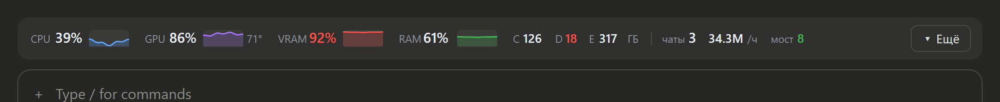
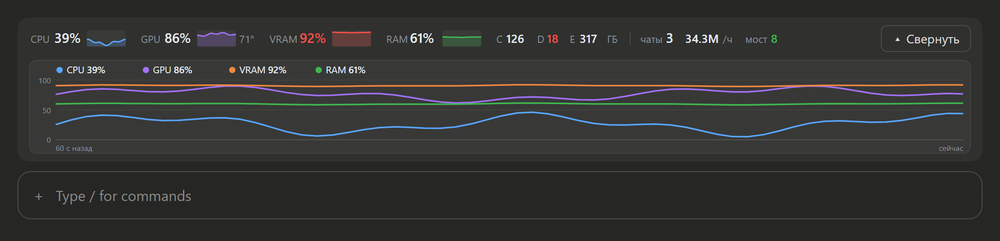
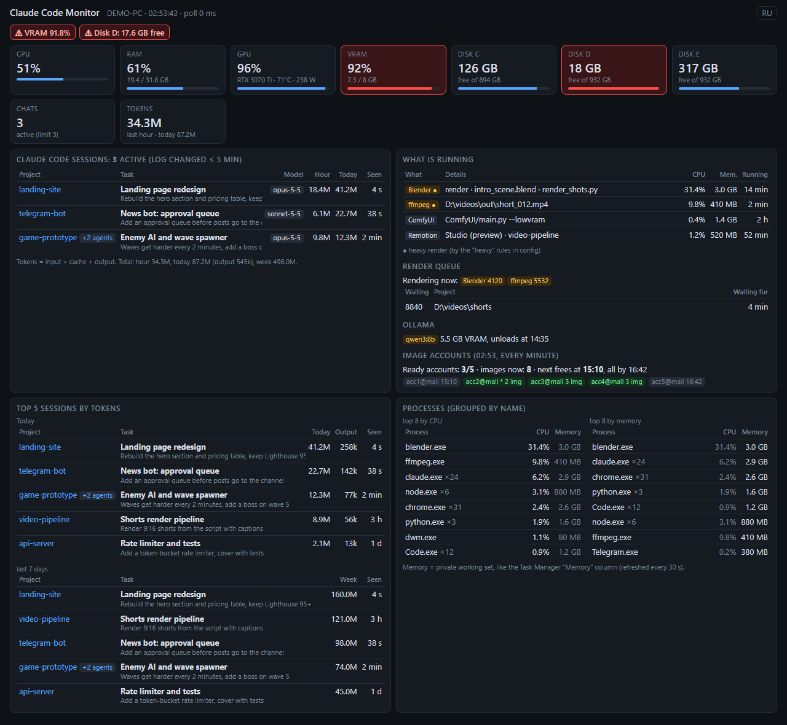
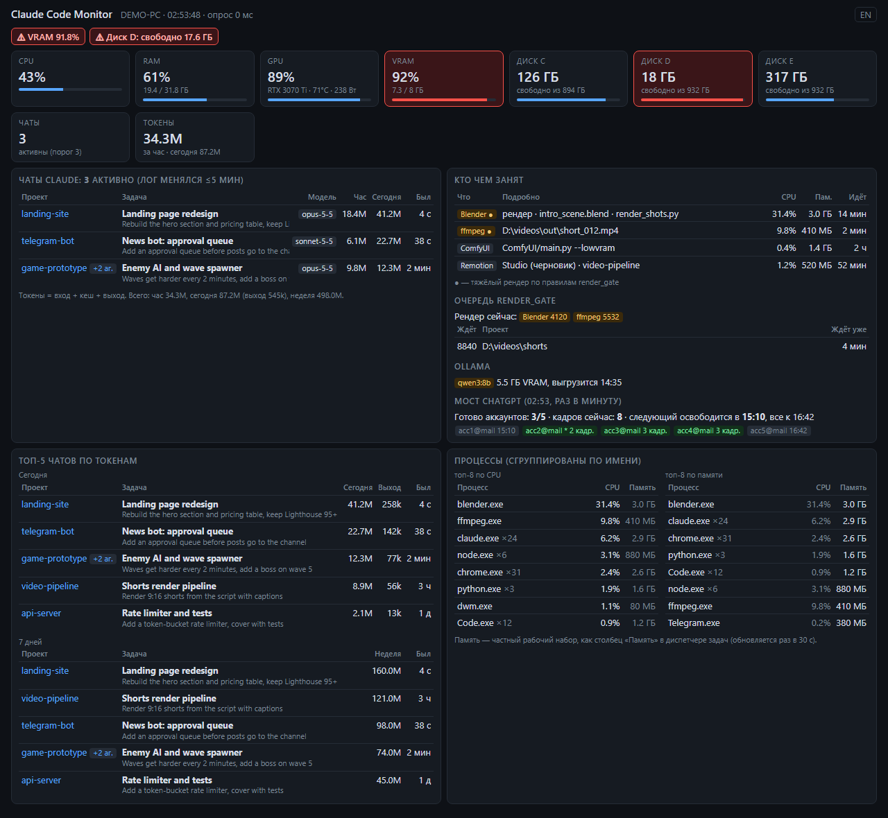

# Claude Code Monitor: token usage, GPU and CPU right above your Claude Code prompt

[](https://www.python.org/)
[](requirements.txt)
[](#2-add-the-monitor-line-to-claude-code)
[](#install)
[](LICENSE)

**Claude Code Monitor** puts one live line above the Claude Code prompt: **CPU, GPU, VRAM and RAM** with small graphs, free disk space, how many **Claude Code sessions** are running, **tokens per hour**, and the render job keeping your machine busy (Blender, ffmpeg, Remotion, ComfyUI). Click **▾** and the same line opens into a one-minute chart and the details. The same data is also a web dashboard you can open on your phone.





Built for people who run several Claude Code chats at once and render video or 3D on the same PC. It answers "who is eating my tokens and my GPU right now" without leaving the chat.

## How it works

Two parts, both local, both read-only:

1. **`monitor.py`**: a small Python server (psutil plus the standard library) that reads Claude Code's session logs, `nvidia-smi` and the process list, and serves the numbers as JSON and as a web page on `127.0.0.1:8770`.
2. **The `pc-monitor` plugin** for Claude Code (`claude-mod/`): it reads that JSON once a second and draws the line above the prompt. It works in the Claude desktop app, in the terminal and in the IDE extensions.
3. **The `side-panel` plugin** (`side-panel/`, optional): a side pane you open with `/panel`, with every project's `STATUS.md` as a card and a "PC now" tab. See [The side panel](#3-optional-the-side-panel-your-projects-at-a-glance).

Nothing is sent anywhere. The server answers only `localhost` and private home-network addresses.

## Install

### The quick way: let Claude do it

Paste this into Claude Code (the desktop app or the terminal) and it installs both parts:

```text
Install Claude Code Monitor for me from https://github.com/Leks2000/claude-code-monitor
1. Clone the repository into a folder in my home directory, then run: pip install -r requirements.txt
2. Start "python monitor.py" in the background and check that http://127.0.0.1:8770/api answers.
3. On Windows, run: powershell -ExecutionPolicy Bypass -File install_autostart.ps1 (so it starts with the PC).
4. Install the plugin for every session:
   claude plugin marketplace add Leks2000/claude-code-monitor
   claude plugin install pc-monitor@leks2000-tools --scope user --config lang=en --config "start_command=<full path to start_monitor.bat> --quiet"
5. Optional, the side panel with my projects: claude plugin install side-panel@leks2000-tools --scope user --config lang=en
   and set "status_roots" in config.json to the folders that hold my projects.
6. Tell me when it is done; I will open a new chat to see the monitor line.
```

Use `lang=ru` for Russian labels. Leave out `start_command` on macOS and Linux.

If you prefer to do it by hand, follow the two steps below.

### 1. Run the server

You need Python 3.9 or newer.

```bash
git clone https://github.com/Leks2000/claude-code-monitor.git
cd claude-code-monitor
pip install -r requirements.txt
python monitor.py
```

Open http://127.0.0.1:8770 to check it. The first start indexes the last 7 days of Claude Code logs, about a minute per 3 GB. After that it only reads new lines.

**Windows, start with the PC:** `powershell -ExecutionPolicy Bypass -File install_autostart.ps1`. This puts a shortcut into your Startup folder, with no admin rights and no system settings changed, plus a **Claude Code Monitor** shortcut on the Desktop. To remove the autostart, press Win+R, type `shell:startup` and delete the shortcut.

### 2. Add the monitor line to Claude Code

**Claude desktop app:** click **+** next to the prompt box, then **Plugins**, then **Add marketplace** and enter `Leks2000/claude-code-monitor`. Then **Add plugin**, choose **pc-monitor**, and open a new chat.

**Terminal (Claude Code CLI):**

```
/plugin install pc-monitor --marketplace Leks2000/claude-code-monitor
```

Answer `y` to add the marketplace, then pick the **user** scope so the line shows in every session.

**From the folder you cloned** (edits to `claude-mod/` apply in the next session, no reinstall):

```bash
claude plugin marketplace add ./claude-code-monitor
claude plugin install pc-monitor@leks2000-tools --scope user
```

Optional settings, in `/plugin configure pc-monitor` or via `--config KEY=VALUE` on install:

| Setting | Default | What it does |
|---|---|---|
| `server_url` | `http://127.0.0.1:8770` | where `monitor.py` runs |
| `start_command` | empty | what the **Start server** button runs, for example `C:\tools\claude-code-monitor\start_monitor.bat --quiet` |
| `lang` | `en` | labels of the line and the pane: `en` or `ru` |

### Using it

- **▾ More** expands the line in place: a one-minute chart, active sessions with tokens per hour, running jobs, top processes, the render queue. **▴ Less** closes it again. The button stays at the right end of the line in both states.
- **Open as a side pane**, at the bottom of the expanded view, opens the same data as a side pane. `/monitor` opens it too, and **✕ Close** closes it.
- `/monitor off` hides the line, `/monitor on` brings it back. `/monitor web` prints the dashboard address.
- Red means over a limit: VRAM above 90%, a drive with less than 20 GB free, more than 3 active sessions.

### 3. Optional: the side panel, your projects at a glance

If you keep a `STATUS.md` in each project (what works, what is broken, the next step), the `side-panel` plugin shows all of them in a pane beside the chat. It opens only when you ask: type `/panel`.

**Install** (after step 1):

```bash
claude plugin marketplace add Leks2000/claude-code-monitor
claude plugin install side-panel@leks2000-tools --scope user --config lang=en
```

In the Claude desktop app: **+** next to the prompt box, **Plugins**, **Add plugin**, **side-panel**. Then tell the server where your projects are, in `config.json`:

```json
{ "status_roots": ["C:\\work", "D:\\video"], "plan_file": "C:\\work\\PLAN.md" }
```

and restart `monitor.py`. Every key is described under [Configuration](#configuration) and [Project board](#project-board).

**What it shows**

- **Projects**: one framed card per `STATUS.md`, grouped by section (games, bots, sites, apps). A card shows the one line that matters most: what **waits** for you, else what is **broken**, else what comes **next**. A yellow frame means something waits for you or is broken, grey means the file is older than 7 days. **▾** opens the whole card. Filters at the top: **All**, **Waiting on me**, **Broken**, **Stale**.
- **Plan**: the current section of your plan file, its latest log entry and a channels table, as Markdown. **Ideas**: every `IDEAS.md` and `BACKLOG.md`, one heading per idea, opened with a click. **No STATUS**: project folders that have no `STATUS.md` yet.
- **PC now**, every 5 seconds: active Claude Code sessions with the first line of each task and tokens for the hour and the day, the top 5 sessions today and this week, CPU, GPU, VRAM and RAM cards with a three-minute graph, free disk space, the top 8 processes, Blender, ffmpeg, Remotion, Python and Roblox Studio jobs, the `render_gate` queue, Ollama and the optional image-bridge status.

**Commands**: `/panel` opens it, `/panel projects` or `/panel pc` opens a tab, `/panel close` (or the pane's ✕) closes it. Settings are the same three as above (`server_url`, `start_command`, `lang`), under `/plugin configure side-panel`.

## The web dashboard

The server also serves a full page with EN and RU switching. It shows every session's tokens for the hour, today and the week, the top 5 sessions, processes grouped like Task Manager, Ollama models and the render queue. On a phone in the same Wi-Fi, open `http://<your-PC-IP>:8770`; the address is printed at start.



## Features

**Claude Code sessions**
- A session counts as active when its log changed in the last 5 minutes.
- For each session: project folder, session title, the first line of the task, model, tokens for the last hour and today, running subagents.
- Top 5 sessions by tokens today and over 7 days, plus totals for the last hour, today and the week. Output tokens are counted separately.
- Duplicate messages are counted once, including a reply split across several log lines and history copied into a forked or resumed session.

**PC load**
- CPU, RAM, GPU, VRAM, GPU temperature and power every second. The GPU numbers come from one long-running `nvidia-smi`, which exits together with the monitor.
- Free space on every drive. Top 8 processes by CPU and by memory, where memory is the private working set, the same as the Task Manager "Memory" column.

**What is running**
- **Blender**: which `.blend` file, and whether it is a render, a background script or an open window.
- **ffmpeg**: the output file. **Remotion**: a render or Studio. **Python**: the script, including ComfyUI. **Roblox Studio**: the place name.
- **Ollama**: the loaded model and its VRAM. **Render queue**: which heavy jobs run now and which `render_gate` scripts are waiting.

**Light**: about 0.4% CPU and 40 MB RAM on a 16-thread desktop. Logs are read from the last byte offset, which is kept in `cache.json` between restarts.

## Configuration

Copy `config.example.json` to `config.json` and change what you need. Every key is optional.

| Key | Default | What it does |
|---|---|---|
| `port` | `8770` | HTTP port |
| `lan` | `true` | also listen on the home network (private IPs only) |
| `lang` | `"auto"` | dashboard language: `"en"`, `"ru"` or `"auto"` |
| `projects_dir` | `~/.claude/projects` | where Claude Code keeps its session logs |
| `disks` | all fixed drives | for example `["C:\\", "D:\\"]` |
| `active_minutes` | `5` | a session is active if its log changed within this many minutes |
| `fast_seconds` | `1` | how often CPU, RAM and GPU refresh. Processes and sessions stay at 5 seconds |
| `limits` | `vram_pct 90, disk_gb 20, chats 3` | alert thresholds |
| `heavy` | Blender `-b`, ffmpeg encode, Remotion | `[process name, text in its command line]` pairs that count as a heavy render |
| `queue_script` | `"render_gate"` | Python scripts with this name are shown as the render queue |
| `project_markers` | `STATUS.md`, `HANDOFF.md`, `CLAUDE.md` | how to find the project folder when a session runs in a parent folder |
| `bridge_cmd` | off | an optional status command polled once a minute |
| `status_roots` | off | folders to search for `STATUS.md` files: turns on the project board (below) |
| `status_depth` | `3` | how many folder levels below a root to search; `docs/STATUS.md` counts for the folder above |
| `status_skip` | `node_modules`, `.git`, `venv`… | folder names never entered |
| `stale_days` | `7` | a project whose `STATUS.md` is older than this is marked stale |
| `sections` | games, bots, sites, apps | `[text in the lowercased path, section name]` pairs; the first match wins |
| `plan_file`, `plan_now`, `plan_log` | off | a plan file, the heading of its current section and of its log (the log's first entry is shown) |
| `channels_file`, `channels_section` | off | a file and the heading of the section to show as it is (a table, say) |
| `ideas_files` | none | extra `IDEAS.md` / `BACKLOG.md` files outside the roots |

## Project board

With `status_roots` set, the server also reads every `STATUS.md` under those folders and serves them as `GET /api/projects`: for each project what works, what is broken, what waits for you and the next step (from `## Works` / `## Not working` / `## Next step` headings, two-column tables or `Next step: ...` lines, in English or Russian), its section and how old the file is. It adds the plan and channels sections you point it at, the headings of every `IDEAS.md` and `BACKLOG.md`, and the project folders that have no `STATUS.md`.

Files are only read. The folders are walked once every 10 minutes; in between, known files are checked every 30 seconds and parsed again only when they change. `python projects.py` prints what the board sees.

## How tokens are counted

Claude Code writes each session to `~/.claude/projects/<folder>/<session-id>.jsonl`, and every assistant message there carries a `usage` block. For each message ID the monitor adds `input_tokens + cache_creation_input_tokens + cache_read_input_tokens + output_tokens` into 5-minute buckets. Subagent logs count toward their parent session.

Cache reads are included, so the totals grow fast: a 150k-token context read 300 times in an hour is 45M tokens. To see how much the model actually wrote, look at the output figure.

## JSON API

`GET /api` returns everything the page and the plugin show, as JSON (`GET /api/projects` is the project board). You can call it from scripts, for example to check VRAM before a render:

```bash
curl -s http://127.0.0.1:8770/api | python -c "import json,sys; d=json.load(sys.stdin); print(d['gpu']['vram_pct'], len(d['chats']['active']))"
```

`python monitor.py --demo --port 8771` serves made-up data. Every screenshot here comes from demo mode.

## Privacy

- Read only: nothing is written to Claude Code's files and nothing goes to the internet.
- The page shows the first line of each prompt and the command lines of processes. Set `"lan": false` on a network you do not trust.
- `cache.json` holds session titles and first prompt lines. It is in `.gitignore`.

## FAQ

**How do I see Claude Code token usage per session?**
Install both parts. The line above the prompt shows the total per hour. Click ▾ for each session's tokens, or open the dashboard for hour, today, week and the top 5.

**How is this different from ccusage?**
[ccusage](https://github.com/ryoppippi/ccusage) is a command-line report of daily and monthly usage and cost. Claude Code Monitor is live, refreshed every second, sits inside Claude Code, and shows the sessions active right now next to the GPU, CPU and the render jobs on the same machine.

**Does it work without an NVIDIA GPU?**
Yes. The GPU and VRAM cells are simply left out.

**Does it slow down renders?**
No. It runs at below-normal priority, keeps one `nvidia-smi` running instead of starting a new one every second, and refreshes the expensive memory numbers every 30 seconds.

**Linux and macOS?**
The server works with psutil and nvidia-smi there too, but only Windows 10 was tested. Window titles (the Blender file, the Roblox Studio place) are read only on Windows.

## Гайд на русском

Монитор показывает над полем ввода Claude Code одну строку: CPU, GPU, VRAM и RAM с мини-графиками, свободное место на дисках, сколько чатов Claude сейчас работает, сколько токенов уходит в час и что рендерится. Кнопка **▾ Ещё** раскрывает эту строку на месте: график за минуту, чаты, задачи, процессы. С настройкой `lang=ru` все подписи на русском.

**Быстрая установка.** Вставьте в Claude Code (приложение или терминал), он поставит всё сам:

```text
Установи мне Claude Code Monitor из https://github.com/Leks2000/claude-code-monitor
1. Склонируй репозиторий в папку в моей домашней директории и выполни: pip install -r requirements.txt
2. Запусти "python monitor.py" в фоне и проверь, что http://127.0.0.1:8770/api отвечает.
3. На Windows выполни: powershell -ExecutionPolicy Bypass -File install_autostart.ps1 (чтобы запускался вместе с ПК).
4. Поставь плагин для всех чатов:
   claude plugin marketplace add Leks2000/claude-code-monitor
   claude plugin install pc-monitor@leks2000-tools --scope user --config lang=ru --config "start_command=<полный путь к start_monitor.bat> --quiet"
5. Скажи, когда закончишь: я открою новый чат и проверю строку.
```

Если хотите поставить руками, вот шаги.

**1. Сервер.** Нужен Python 3.9+.

```bash
git clone https://github.com/Leks2000/claude-code-monitor.git
cd claude-code-monitor
pip install -r requirements.txt
python monitor.py
```

Проверка: откройте http://127.0.0.1:8770. Чтобы монитор запускался вместе с Windows, выполните `powershell -ExecutionPolicy Bypass -File install_autostart.ps1`: в автозагрузке появится ярлык, права администратора не нужны.

**2. Строка в Claude.**
- **Приложение Claude:** **+** у поля ввода, затем **Plugins**, затем **Add marketplace**, введите `Leks2000/claude-code-monitor`. Потом **Add plugin**, выберите **pc-monitor** и откройте новый чат.
- **Терминал:** `/plugin install pc-monitor --marketplace Leks2000/claude-code-monitor`, на вопрос ответьте `y`, область **user**.
- **Из скачанной папки:** `claude plugin marketplace add ./claude-code-monitor`, затем `claude plugin install pc-monitor@leks2000-tools --scope user --config lang=ru`. Правки в `claude-mod/` подхватятся в следующем чате.
- Язык потом меняется так: `/plugin configure pc-monitor`, поле **Language**.

**Панель проектов (по желанию).** Если в каждом проекте есть `STATUS.md` (что работает, что не работает, следующий шаг), плагин `side-panel` показывает их все в панели справа от чата. Открывается только по команде `/panel`.

```bash
claude plugin marketplace add Leks2000/claude-code-monitor
claude plugin install side-panel@leks2000-tools --scope user --config lang=ru
```

Затем в `config.json` сервера укажите папки с проектами — `"status_roots": ["C:\\work", "D:\\video"]` (по желанию `plan_file`, `channels_file`, `ideas_files`) — и перезапустите `monitor.py`. Вкладка «Проекты»: карточка на каждый `STATUS.md` с одной главной строкой (ждёт тебя, сломано или дальше), жёлтая рамка — что-то ждёт тебя или сломано, серая — файл старше 7 дней, ▾ раскрывает карточку целиком, фильтры «Все», «Ждут меня», «Сломано», «Давно». Ещё есть план, идеи и папки без `STATUS.md`. Вкладка «ПК сейчас» обновляется раз в 5 с: чаты и токены, нагрузка, процессы, рендеры. `/panel close` или ✕ закрывает панель. Файлы только читаются.

**3. Команды.** `/monitor` открывает панель справа, `/monitor off` и `/monitor on` прячут и возвращают строку, `/monitor web` даёт адрес веб-панели. Веб-панель открывается и с телефона в той же Wi-Fi: `http://<IP-компьютера>:8770`.



## License

[MIT](LICENSE)
